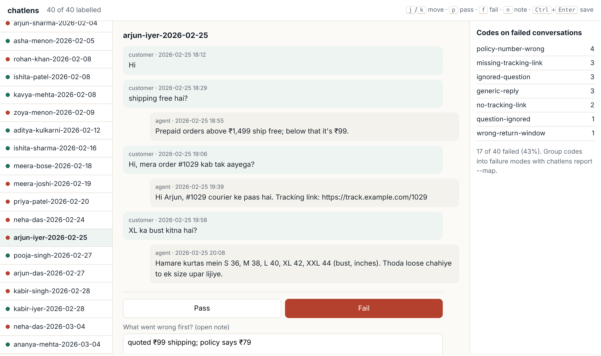

# chatlens

A local workbench for the least glamorous and most useful part of evaluating a chat agent:
reading its conversations, one at a time, and writing down what went wrong.

**Try it in the browser (sample data, nothing leaves your machine):** https://yashere69.github.io/chatlens/



```bash
pip install git+https://github.com/yashere69/chatlens
chatlens import prod-calls.jsonl --from chat-logs -o traces.jsonl
chatlens serve traces.jsonl            # opens http://127.0.0.1:8765
```

## Getting conversations in

| Source | Command |
|---|---|
| Logged chat-completions calls, one `{"messages": [...]}` (or a bare list) per line, the shape most apps already log | `chatlens import calls.jsonl --from chat-logs` |
| WhatsApp exports | `chatlens import "WhatsApp Chat with Asha.txt" --business "Your Store"` |
| [turncheck](https://github.com/yashere69/turncheck) runs | `turncheck run ... --transcripts runs.jsonl`, then `chatlens serve runs.jsonl` directly |
| Anything else | write `{"id", "turns": [{"role", "text"}]}` per line; roles are customer, agent, tool, system |

For chat logs, `user` becomes customer and `assistant` becomes agent. Tool calls on an
assistant message become `tool` turns showing the function and its arguments, and list-style
content keeps only its text parts.

## The method

Hamel Husain and Shreya Shankar have made a simple case in their writing on LLM evals:
before writing any eval, read real traces and do *error analysis*.

1. **Open coding.** For each conversation, mark pass or fail, then write a note and a short
   code for the first thing that went wrong.
2. **Axial coding.** Group the codes into a handful of failure modes.
3. **Count.** The most common failure modes are the evals worth writing.

General observability tools can store traces, but a dashboard isn't where this reading
happens. chatlens is built for that one job:

- One conversation on screen, laid out like the chat it was
- `j`/`k` to move, `p` to pass and advance, `f` to fail and jump to the note, `Ctrl+Enter`
  to save and advance. No mouse needed.
- Codes autocomplete from the ones you've already used, so twenty traces in, you're not
  inventing a fourth spelling of the same thing
- A live count of codes on failed conversations, so the patterns show up while you work
- Every save rewrites `labels.jsonl` through a temp file and a rename
  so a crash can't leave it half-written

## Why not Label Studio, Argilla, or your tracing tool?

Those are better choices when you need them. [Label Studio](https://labelstud.io/) and
[Argilla](https://argilla.io/) are general annotation platforms: many task types, teams,
review queues. [Langfuse](https://langfuse.com/guides/cookbook/error-analysis-llm-applications)
and [Phoenix](https://arize.com/docs/phoenix) have annotation queues next to traces you've
already sent them. Hamel Husain's advice is to build a small custom annotation tool for your
own data, and there are now agent skills that generate one per project.

chatlens is for the case in between: chat transcripts, one or two reviewers, and data that
shouldn't go anywhere. It is `pip install` and one command, with no account and no server to
run, and the conversations stay in a JSONL file on your laptop. That matters when the
transcripts are your clients' customers, and India's DPDP Act puts obligations on sharing
them. It knows the open-then-axial-coding loop: codes with autocomplete,
`suggest`, `agree` for two reviewers. It also ends in regression tests, not a dashboard.

## After labelling

```bash
chatlens report labels.jsonl --map axial.yaml     # failure-rate table
chatlens suggest labels.jsonl --compare axial.yaml
chatlens agree labels-asha.jsonl labels-ravi.jsonl --map axial.yaml
chatlens export traces.jsonl labels.jsonl -o scenarios/
```

`axial.yaml` is your grouping:

```yaml
policy-error: [wrong-shipping-fee, fee-amount-wrong, policy-number-wrong, wrong-return-window]
missing-info: [missing-tracking-link, no-tracking-link]
non-answer:   [ignored-question, question-ignored, generic-reply]
```

On the sample data:

```
40 traces labelled, 17 failed

failure mode              traces    rate
non-answer                     7     18%
policy-error                   5     12%
missing-info                   5     12%
```

**`suggest`** proposes a grouping from your codes alone, by shared content words with
"wrong", "missing" and "no" ignored (no model involved). With `--compare` it shows, for each
suggested group, which of your failure modes its traces fall in, plus the adjusted Rand
index between the two groupings (1 when they group the failed traces identically; splitting
or merging lowers it). On the sample:

```
5 suggested groups vs 3 in examples/axial.yaml, over 17 failed traces
adjusted Rand index 0.69 (1 = same grouping; splitting or merging lowers it)
  generic (3) -> non-answer 3
  ignored (4) -> non-answer 4
  link (5) -> missing-info 5
  number (4) -> policy-error 4
  window (1) -> policy-error 1
```

No suggested group mixes two of your modes, but it splits two of them, because "generic
reply" and "ignored question" share no words. That's typical: word overlap finds spelling
variants, not concepts. Use it as a second pair of eyes on your axial coding, not a
replacement for it.

**`agree`** is for two people who labelled the same sample, each in their own file. It
prints how many traces both labelled, raw verdict agreement, Cohen's kappa, kappa over
failure modes for traces both failed (with `--map`), and the traces where they differ.
Those disagreements are the conversations to talk through before splitting the rest of the
work.

**`export`** turns every failed conversation into a [turncheck](https://github.com/yashere69/turncheck)
scenario, with the customer's messages replayed in order and the note kept as the name.
You tighten the `expect_reply` steps to describe the correct behaviour, and the failure
becomes a regression test.

## Sample data

`examples/traces.jsonl` comes from a [nakli](https://github.com/yashere69/nakli) chat
export for a fictional store. `tools/make_sample.py` planted four kinds of agent mistakes
in 17 of the 40 conversations: a wrong shipping fee, a wrong return window, a missing
tracking link, and a canned non-answer. `labels.jsonl` marks them with the inconsistent
codes real reviewers produce ("missing-tracking-link" vs "no-tracking-link"), which is
exactly what axial coding exists to tidy up.

## Design notes

- **Local only, and defended against other tabs.** The server binds to 127.0.0.1, since
  conversations usually contain customer data. Binding to localhost doesn't stop *other web
  pages* in your browser from talking to it, so:
  - every request must carry `Host: 127.0.0.1:<port>` or `localhost:<port>`, which defeats
    DNS rebinding (a hostile domain re-pointed at 127.0.0.1 would otherwise read
    `/api/traces`);
  - label writes must be `application/json`, which a plain form can't send without a CORS
    preflight the server never grants; a mismatched `Origin` is refused; and bodies are
    capped at 64 KB;
  - the page is served with a Content-Security-Policy that allows only its own inline
    script and style, by SHA-256 hash, and forbids framing. Conversation text is escaped
    before it's rendered, and the CSP is the second line if that ever slips. `tests/test_ui.py`
    loads a conversation containing an `` payload to check both.
- **One HTML file, no build step.** The page is about 210 lines of HTML, CSS and plain
  JavaScript, shipped inside the Python package. The Pages demo is the same file: when
  `/api/traces` isn't there, it loads the sample, keeps labels in `localStorage`, and
  offers a download.
- **JSONL in, JSONL out.** Both are easy to produce from any logging setup and easy to diff
  in git. Labelling decisions become reviewable like code.
- **First failure only.** The note asks what went wrong *first*. Later errors in a
  conversation are often caused by the first, and counting them separately inflates the
  wrong failure mode. This follows the error-analysis advice above.

## Tests and scale

`pytest` covers the store, importers, analysis, CLI and the server's defences, including
DNS-rebinding Host headers, oversize bodies and damaged label files. `tests/test_ui.py`
drives the page in headless Chromium: the keyboard flow end to end, hostile HTML in a
conversation, the current row staying in view, and an [axe](https://github.com/dequelabs/axe-core)
scan that must find no serious or critical violations. It runs in the `ui` CI job, or
locally after `pip install -e ".[dev,ui]" && python -m playwright install chromium`.

`python tools/ui_latency.py 200 2000 10000` measures the page with synthetic two-turn
conversations (Playwright 1.63 with headless Chromium, on a Linux cloud container, 8 Nov 2026):

| conversations | page load | per `j` | per `p` (label + save) |
|---|---|---|---|
| 200 | 0.10 s | 5 ms | 32 ms |
| 2,000 | 0.16 s | 7 ms | 26 ms |
| 10,000 | 0.29 s | 21 ms | 47 ms |

Your machine will differ. The point is the shape: the list is built once and patched per
keypress, so move time grows slowly with list size. Before this, every keypress rebuilt the
whole list and took about 200 ms at 10,000 conversations. Saving rewrites the whole labels
file, which is the next thing to change if you label tens of thousands of traces.

## Limits

- One file per reviewer. `agree` compares two reviewers' files, but there's no merge into a
  single file and no adjudication view.
- Tool calls show up only if your traces include `"role": "tool"` turns. The WhatsApp
  importer only knows customer and store messages.
- No LLM-assisted clustering of notes. `suggest` works on codes, not free text.
- The server is single-user and has no login. It is safe against other pages in your
  browser, not against other users of the same machine.

Stable: the trace and label file formats, and the CLI commands. Experimental: `suggest`'s
grouping heuristic, and the page layout.

## Development

```bash
pip install -e ".[dev,ui]" && python -m playwright install chromium
ruff check . && ruff format --check . && mypy src && pytest
```

The whole UI is `src/chatlens/static/index.html`; there is no build step, so edit it and
reload. Any change to it should keep `tests/test_ui.py` passing, including the axe scan.
The sample data comes from `tools/make_sample.py` (a nakli export with planted mistakes),
and `tools/ui_latency.py` reruns the latency table above.

MIT licensed.
